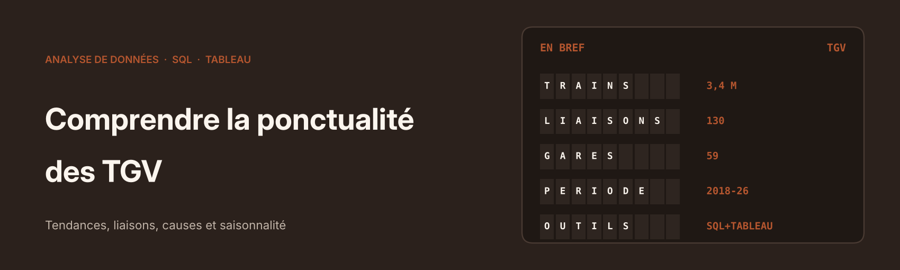
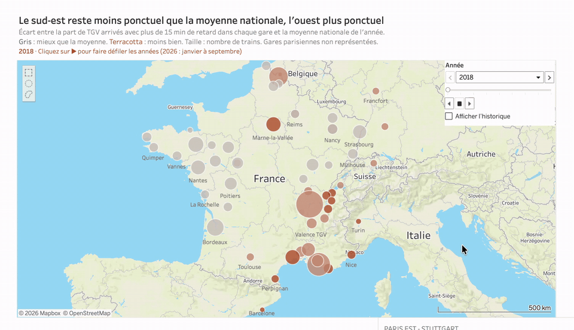
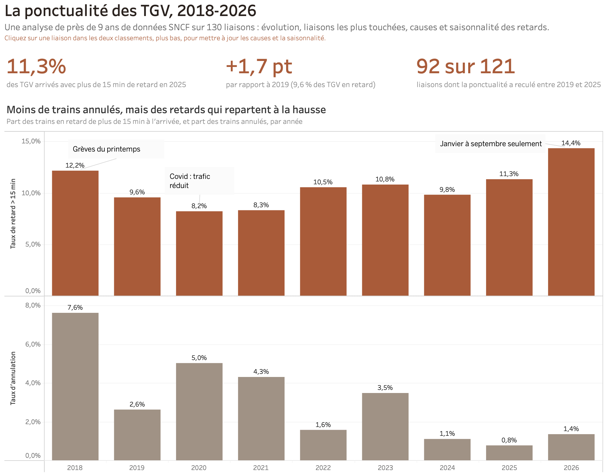
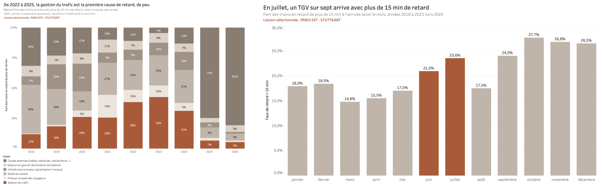

<p align="center">
  
</p>

<p align="center">
  
  
  
</p>

# Comprendre la ponctualité des TGV, 2018-2026

Projet personnel d'analyse de données.

Ce projet étudie la ponctualité des TGV à partir des données ouvertes publiées par la SNCF et l'AQST (près de 9 ans, 130 liaisons), pour comprendre où, quand et pourquoi les retards se concentrent. Les données sont nettoyées et enrichies en SQL, puis présentées dans un tableau de bord interactif sous Tableau : tendance, liaisons, causes, saisonnalité et carte des gares.

**[Voir le tableau de bord](https://public.tableau.com/views/PonctualitdesTGV2018-2026/PonctualitTGV)** · [journal de nettoyage](NETTOYAGE.md) · [scripts SQL](sql/)

## En bref

- **Questions :** comment la ponctualité évolue-t-elle depuis 2018 ? Quelles liaisons sont les plus concernées ? Quelles sont les causes des retards ? Certains mois sont-ils plus difficiles ?
- **Données :** « Régularité mensuelle TGV par liaisons » (SNCF, AQST), janvier 2018 à septembre 2026, enrichie avec les coordonnées du référentiel des gares de voyageurs.
- **Méthode :** nettoyage documenté décision par décision, taux pondérés par le nombre de trains, contrôles croisés entre SQL et Tableau.

## Résultats

| | |
|---|---|
| **11,3 %** | des TGV arrivés avec plus de 15 min de retard en 2025, contre 9,6 % en 2019 |
| **92 sur 121** | liaisons dont la ponctualité a reculé entre 2019 et 2025 |
| **12,7 % / 7,3 %** | TGV en retard en 2025 au départ de Paris Gare de Lyon, contre Paris Nord |
| **14,2 %** | TGV en retard en juillet, contre 8,5 % en mars |



- **Des annulations en forte baisse.** Elles sont passées de 2,6 % des trains en 2019 à 0,8 % en 2025. Les retards, eux, sont remontés après le creux de 2020-2021.
- **Des écarts marqués selon les axes.** Nice, Marseille et Chambéry font moins bien que la moyenne nationale chaque année depuis 2018 ; Rennes, à l'inverse, fait mieux chaque année. Les liaisons entre régions sans passer par Paris (Lille – Marseille, Lyon – Lille…) sont les moins ponctuelles en 2025 (17,3 %), tout comme certaines liaisons internationales.
- **Des causes partagées.** De 2022 à 2025, la gestion du trafic arrive en tête, mais de peu (22 à 24 % des retards de plus de 15 min), devant l'infrastructure, le matériel roulant et les causes externes.
- **Un effet saisonnier net.** Juin et juillet sont les mois les plus concernés, mars le moins.

2026 ne couvre que janvier à septembre : ses chiffres sont signalés comme partiels dans le tableau de bord.

## Le tableau de bord



- trois chiffres-clés calculés par Tableau, identiques aux résultats des requêtes SQL ;
- des titres qui énoncent le constat, et pas seulement le sujet du graphique ;
- un clic sur une liaison filtre les graphiques des causes et de la saisonnalité, et leur titre affiche la liaison sélectionnée ;
- une carte animée des gares, colorée selon l'écart à la moyenne nationale de chaque année.



## Démarche

1. **Nettoyage** (`sql/01` à `sql/05`). 15 problèmes identifiés et traités : faux doublons (flux National et International sur une même liaison), mois sans train pendant le confinement, causes de retard manquantes, colonnes mélangées sur trois mois de 2025, valeurs incohérentes. Chaque décision est justifiée et chiffrée dans le **[journal de nettoyage](NETTOYAGE.md)**.
2. **Table des causes** (`sql/06`). Passage en format long (`UNPIVOT`) et pondération par le nombre de trains en retard.
3. **Enrichissement géographique** (`sql/07` à `sql/10`). Rapprochement des 59 gares avec le référentiel SNCF : 37 par normalisation automatique des noms, 14 choisies à la main parmi des candidats, 8 gares étrangères ajoutées manuellement. Les cas ambigus (Lille, Montpellier, Italie) sont documentés.
4. **Tables pour la carte** (`sql/11` à `sql/13`). Agrégation par gare et par année, avec la moyenne nationale de chaque année.
5. **Contrôles croisés.** Les mêmes chiffres sont obtenus en SQL et dans Tableau : 92 liaisons sur 121, 11,3 % en 2025, moyennes nationales année par année.

## Points de vigilance

- **Taux pondérés.** Tous les taux sont un total de trains en retard divisé par un total de trains partis. Une moyenne des taux par liaison donnerait le même poids à une liaison de 200 trains qu'à une liaison de 15 000 trains.
- **Classements « Top 15 » dans Tableau.** Le filtre d'année doit être ajouté au contexte : sinon, Tableau calcule le Top 15 sur toutes les années avant de filtrer, et le classement est faux.
- **Causes de retard.** Elles ne portent que sur les trains arrivés avec plus de 15 min de retard.
- **Carte.** Un train compte pour ses deux gares : la carte mesure la ponctualité des TGV qui desservent une gare, pas la responsabilité de la gare. Les gares parisiennes, qui desservent toute la France, ne sont pas représentées.

## Reproduire

Les données ne sont pas incluses dans le dépôt. Les télécharger dans un dossier `data/` :
- [Régularité mensuelle TGV par liaisons](https://www.data.gouv.fr/datasets/regularite-mensuelle-tgv-par-liaisons) (SNCF, AQST), sous le nom `regularite-mensuelle-tgv-aqst.csv` ;
- [Gares de voyageurs](https://www.data.gouv.fr/datasets/gares-de-voyageurs-1) (SNCF Gares & Connexions), sous le nom `gares-de-voyageurs.csv`.

Puis, depuis la racine du projet, avec [DuckDB](https://duckdb.org) :

```
duckdb ponctualite.duckdb
.read sql/01_import.sql
.read sql/03_table_propre.sql
...
```

Les scripts s'exécutent dans l'ordre de leur numéro (détail dans [sql/](sql/)). `02`, `05` et `09` sont des scripts de diagnostic : ils n'écrivent aucune table et peuvent être sautés.

## Structure

```
├── README.md
├── NETTOYAGE.md     journal des 31 décisions de nettoyage et de modélisation
├── sql/             13 scripts DuckDB, numérotés dans l'ordre d'exécution
└── assets/          bannière, captures et animation du tableau de bord
```

## Auteure

**Yaye Fatou Lam** · [LinkedIn](https://www.linkedin.com/in/yaye-fatou-lam-258925412)
